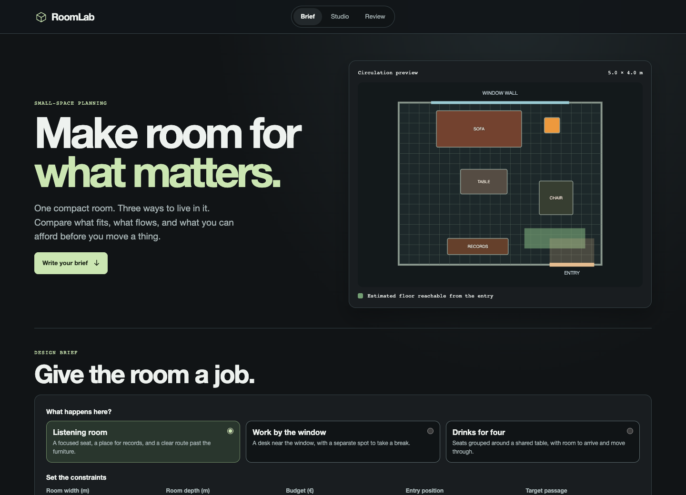
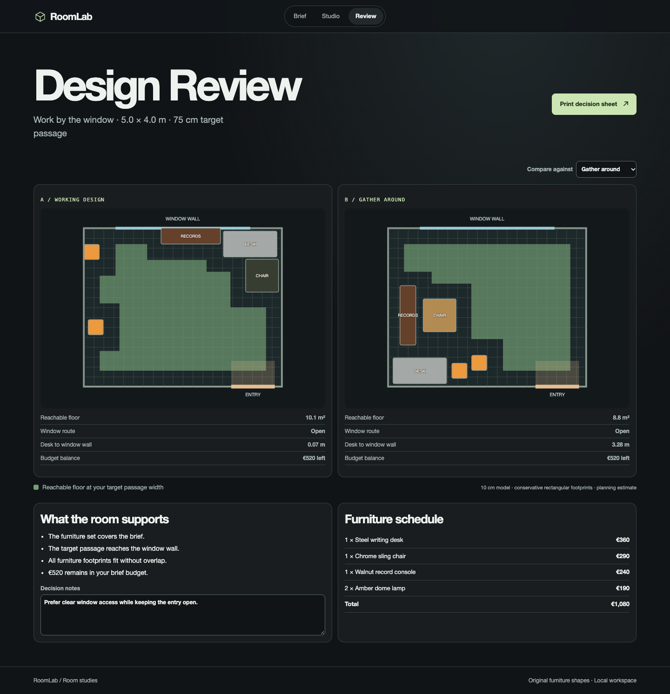

# RoomLab · Small Space Design Studies

A browser studio for answering a practical interior design question: **how should I arrange a compact room for the way I use it?** Start with a brief, compare generated layouts against the same constraints, then refine a design in 3D and record the trade-offs.



- **Brief.** Pick a use case or customize the furniture set. Set the dimensions, entry location, budget, and target passage width. The search returns up to three alternatives with different priorities.
- **Studio.** Edit the proposal in 3D or plan view, choose materials, inspect it from eye level, and switch to **Flow** to see how your edits affect the reachable floor.
- **Review.** Compare the working layout with an alternative, look at window access and the furniture schedule, and print a decision sheet with your notes.



## Run locally

On the Mac where the project was created, open this folder in VS Code and run `./run-local.sh` in its terminal. It uses the Node.js runtime installed for this workspace.

On another machine, use Node.js 24 LTS and npm:

```sh
npm ci
npm run dev
```

Open the local URL printed by Vite. Run `npm test` for geometry and budget checks and `npm run build` for a type check and release build.

## How it works

- `src/layout.ts` defines furniture in metres and computes footprints and price totals. Rotation uses 90° increments, so rectangular footprints can be compared directly. The catalogue searches a 10 cm grid for a free footprint when adding furniture.
- `src/scene.tsx` renders original furniture shapes with Three.js and React Three Fiber. Dragging projects the pointer onto the floor and snaps to a 5 cm grid.
- `src/main.tsx` connects the scene to the inspector, budgets and browser storage. Select an item in the sidebar to edit its coordinates without dragging.

The study currently models one rectangular room, a window wall and one fixed-width entry on the opposite wall. It uses conservative rectangular furniture footprints and a 10 cm grid. This is a planning estimate: it does not simulate real door swings, wall irregularities, wheelchair turns, or building-code compliance. The furniture and prices are illustrative. The brief, proposals, notes and any explicitly saved layout stay on this device; there are no accounts or cloud sync.

## How the layout search works

`src/study.ts` generates repeatable trial layouts from a seeded sampler. It removes candidates that overlap furniture, cross room boundaries, obstruct the entry or exceed budget. For each of three priorities, it ranks the viable layouts on reachable floor, window access and proximity to focal furniture. `src/study.worker.ts` runs the search away from the UI thread. It is a bounded heuristic, not an exhaustive solver; “no layout found” means the search did not find one under those settings.

For circulation, the analyser expands footprints and insets walls using half the requested passage width, then flood-fills the remaining grid from the entry. This estimates where the centre of that passage can reach. Review reports that area, window-wall access, and cost as separate measures. A common furniture set keeps proposals comparable; budget changes when you add or remove pieces.

## Live city lighting

Open **Light by city**, search for a city, and choose a result. RoomLab calls [Open-Meteo Geocoding](https://open-meteo.com/en/docs/geocoding-api) to find the coordinates and the [Forecast API](https://open-meteo.com/en/docs) for the city's current day/night state, cloud cover and today's sunrise and sunset. The model changes to day or evening and softens the directional light as daytime cloud cover rises. This is an artistic approximation, not a study of real sun angles or window exposure.

The browser sends the city search and selected coordinates to Open-Meteo. No key is needed for this non-commercial project. A reading is a snapshot; use **Refresh light** for a fresh one, or switch to the manual Day and Evening presets, which also work offline.

## Demo walkthrough

1. Switch between evening and daylight, then use **Plan** to see the furniture footprints.
2. Add a desk and rotate or move it. A fit warning appears if it crosses a wall or overlaps another piece. Undo and redo the edit with the toolbar or the standard keyboard shortcuts; a whole drag is one history step.
3. Open **Share layout** to copy a URL that opens an editable snapshot. The versioned URL fragment carries the layout and finishes without a database or account. A localhost URL only works on the same device; host RoomLab to share with other people.
4. Select **Export PNG** to preview the current 3D scene or plan and download it without the interface. Use **Light by city** for a live lighting variation.

The glass controls use [Glisse](https://github.com/0kzh/glisse) by Kelvin Zhang (MIT). Supporting controls fall back to frosted glass on browsers without live backdrop refraction. The app, scene, history, and snapshot data are separate so the core behavior can be tested without a browser.

## Design desk and room views

Use **Room scheme** to compare three palettes across the same furniture layout. A scheme changes the room surfaces, rug and default seat finishes; finishes picked on an individual piece override its scheme. Schemes are included in browser saves and layout links.

Use **Dollhouse** or **Plan** to arrange furniture, then choose **Inside** for an eye-level inspection. Switch between two viewpoints or drag the scene to look around. Select a piece in the room to open its dimensions and finish controls under **Furniture**.

The object catalogue shows original product renders of the exact mesh used in the room. RoomLab generates the six thumbnails with one offscreen renderer and displays the finished images as static thumbnails. These are concept designs and illustrative prices, not retail listings.
